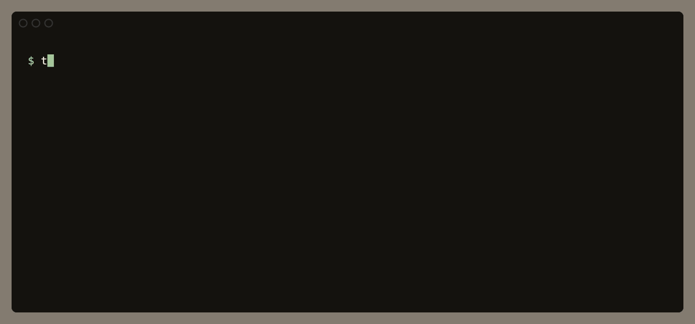

<h1 align="center">torrential</h1>

<p align="center">Search and download torrents from your terminal, or ask your coding agent to.</p>

<p align="center">
  
</p>

## Install

You need Rust and Nix with flakes turned on.

```sh
git clone --recursive https://github.com/nexxeln/torrential
cd torrential
nix develop -c cargo install --path crates/torrential
```

## Use it

Run `torrential` with no arguments to open the terminal UI.

Or run the commands yourself:

```sh
torrential search big buck bunny        # each result starts with a short ID
torrential get b63eaa --files '*.mp4'   # download only the files you want
torrential wait b63eaa                  # follow a download until it is done
torrential status                       # list your downloads
torrential pause b63eaa                 # pause a download
torrential resume b63eaa                # continue it, or retry a failed one
torrential rm b63eaa                    # stop tracking it, and keep its files
```

An ID is the start of the torrent's infohash, and any unique prefix of 4 or more characters works. `get` also takes a magnet link, a full infohash, or a `.torrent` file or URL.

On a terminal, `get` shows progress until the download is done. Downloads run in a background engine, so they keep going after you press Ctrl-C or close the terminal.

Every command takes `--json` for scripts, and `torrential schema` describes the commands, their output, and their errors.

## With your agent

Install the skill that teaches agents to use torrential:

```sh
torrential skill install
```

It installs the skill for Claude Code, and for Codex, Gemini CLI, Cursor, and other agents that read `~/.agents/skills`. Then ask for what you want in plain words. Here is what a fresh Claude Code session ran for this request:

```text
> Download the public-domain film Night of the Living Dead (1968) for me.
> I only want one MP4 of the movie, not the big remux or Blu-ray files.

$ torrential search night of the living dead 1968 --source archive.org --category video
$ torrential files c85f98
$ torrential get c85f98 --files "Night of the Living Dead (1968).mp4" --dry-run
$ torrential get c85f98 --files 'Night of the Living Dead (1968).mp4'
$ torrential wait c85f98
# still running after 100s · eta 1m
$ torrential wait c85f98
# done after 70s · path …/night-of-the-living-dead-1968_202110
```

It chose the public-domain original over the 55 GiB remux, picked one 1.8 GiB MP4 out of five files, and checked back with `wait` instead of `sleep`. The download does not depend on the agent, so a later session can check on it with `torrential status`.

Agent sandboxes block the connections BitTorrent needs. torrential checks for a sandbox before it starts, and the skill tells the agent what to do about it.

## Settings

torrential reads `~/.config/torrential/config.toml`. Downloads go to a `torrential` folder in your Downloads folder unless you set another:

```toml
[downloads]
dir = "~/Downloads/torrents"
```

## It never seeds

torrential never uploads a piece, and a download stops as soon as it finishes. Among equally good matches it puts lawful sources such as archive.org and official Linux torrents first, and you should download only what you have the right to.

## License

MIT. See [LICENSE](LICENSE).
